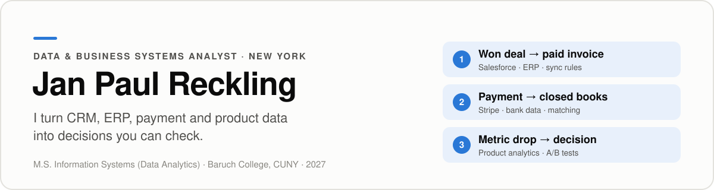
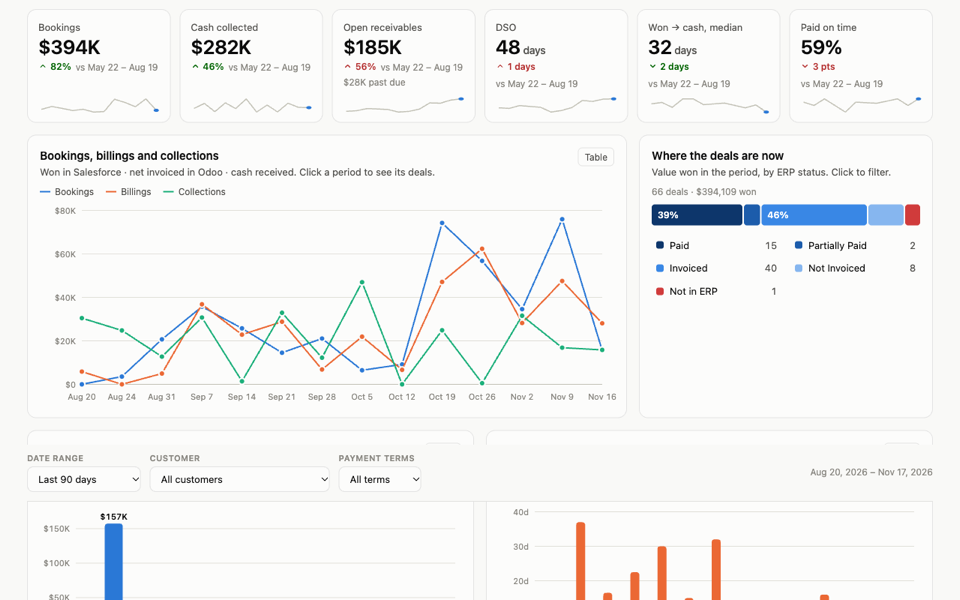
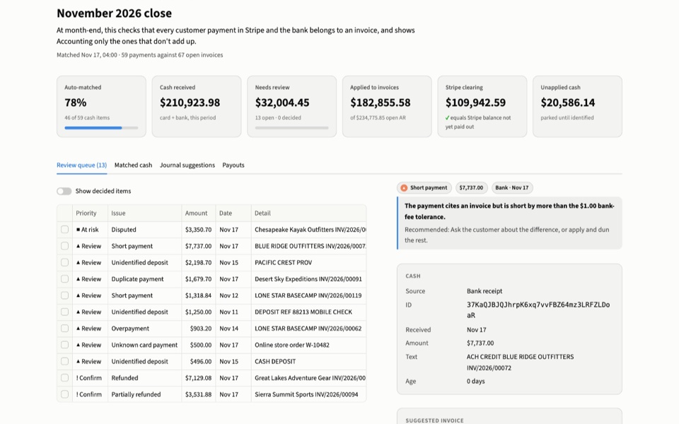
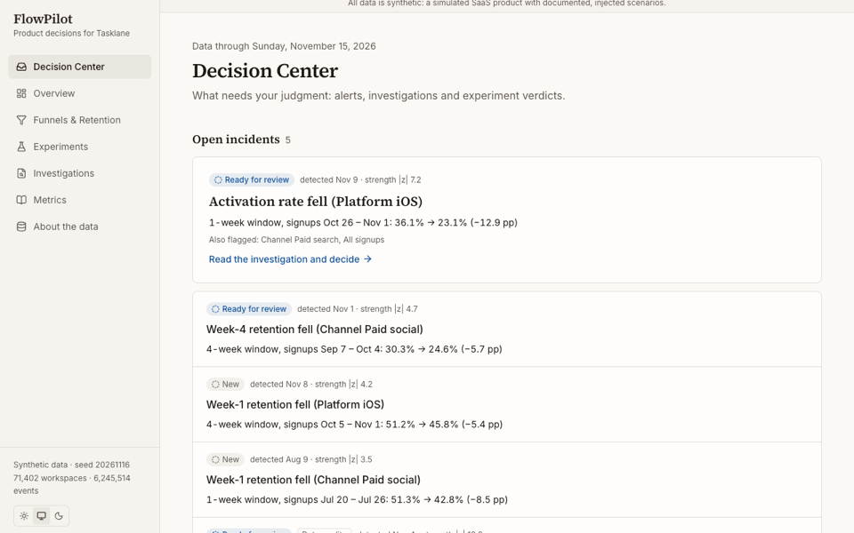

<picture>
  <source media="(prefers-color-scheme: dark)" srcset="img/banner-dark.svg">
  
</picture>

  <a href="https://janpaulreckling.github.io"><b>Portfolio</b></a> ·
  <a href="https://www.linkedin.com/in/janpaulreckling/"><b>LinkedIn</b></a>

My portfolio follows one fictional company, **Northwind Outfitters**, an outdoor retailer, from a won deal to cash in the bank. Those projects run against real systems: a Salesforce org, an ERP, and payment and bank test data. A third project moves to product analytics on synthetic data. Every result below is measured on the project's own data.

<table>
  <tr>
    <td width="33%" valign="top">
      
      <h3>order-to-cash-sync</h3>
      <i>Where do orders get stuck between deal and cash?</i>
      
Syncs won Salesforce deals into the ERP and writes invoice and payment status back.

      
<b>137</b> deals synced, <b>0</b> duplicate orders

      <a href="https://janpaulreckling.github.io/order-to-cash-sync/dashboard/">Live dashboard</a> · <a href="https://github.com/janpaulreckling/order-to-cash-sync">Code</a>
    </td>
    <td width="33%" valign="top">
      
      <h3>cash-reconciliation-engine</h3>
      <i>Does every payment tie out to an invoice?</i>
      
Matches Stripe and bank payments to ERP invoices and shows Accounting only the exceptions.

      
<b>76%</b> matched automatically, <b>0</b> wrong matches

      <a href="https://northwind-cash-recon.streamlit.app">Live app</a> · <a href="https://github.com/janpaulreckling/cash-reconciliation-engine">Code</a>
    </td>
    <td width="33%" valign="top">
      
      <h3>FlowPilot</h3>
      <i>Why did activation drop, and should we ship?</i>
      
Detects metric drops, explains them with checkable evidence and judges A/B tests.

      
<b>3 of 3</b> injected problems found, <b>4 of 4</b> test verdicts right (synthetic data)

      <a href="https://janpaulreckling.github.io/flowpilot/">Live demo</a> · <a href="https://janpaulreckling.github.io/flowpilot/case-study">Case study</a> · <a href="https://github.com/janpaulreckling/flowpilot">Code</a>
    </td>
  </tr>
</table>

### Where to start

- **1 minute:** the [portfolio site](https://janpaulreckling.github.io)
- **2 minutes:** the [FlowPilot case study](https://janpaulreckling.github.io/flowpilot/case-study)
- **5 minutes:** click through the [dashboard](https://janpaulreckling.github.io/order-to-cash-sync/dashboard/), the [reconciliation app](https://northwind-cash-recon.streamlit.app) and the [FlowPilot demo](https://janpaulreckling.github.io/flowpilot/)

### About me

M.S. Information Systems (Data Analytics) at Baruch College, CUNY, May 2027. Before that: payments analytics at Flatpay, business systems at Gistable, accounting and controlling at DHL.

**Tools:** SQL · Python · dbt · DuckDB · Tableau · Power BI · Salesforce · NetSuite · Odoo · GitHub Actions
